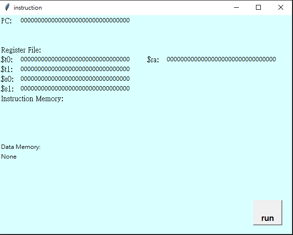

# MIPS 組譯器與模擬器


用 Python 和 tkinter 寫的小型 MIPS 組譯器與單步模擬器。
程式會讀取 MIPS 組合語言檔案，每按一次按鈕執行一行指令，並顯示 PC、暫存器的值，以及每行指令對應的 32 位元機器碼。

本專案原本是大學課堂的實驗作業，後來重新整理並擴充功能。



## 功能

- 按下 **run** 按鈕逐行執行
- 顯示 PC、暫存器、指令記憶體（機器碼）和資料記憶體
- 支援標籤（label），可用於分支與跳躍
- 支援的指令：

| 類型 | 指令 |
|------|------|
| R-type | `add`、`addu`、`sub`、`and`、`or`、`nor`、`slt`、`sltu`、`sll`、`srl`、`sra`、`jr` |
| I-type | `addi`、`addiu`、`slti`、`lw`、`sw`、`beq`、`bne` |
| J-type | `j`、`jal` |

## 環境需求

- Python 3.10 以上（notebook 版本使用了 `match` 語法）
- tkinter（大多數 Python 安裝時已內建）

## 使用方式
1. 把 `lab03.ipynb` 和要執行的組合語言檔 `code.txt` 放在**同一個資料夾**
2. 用 Jupyter 開啟 `lab03.ipynb`
3. 選單 **Kernel → Restart & Run All Cells**，會跳出模擬器視窗
4. 按下 **run** 執行下一行指令，程式結束時會跳出「輸出完畢」
想換測資時，修改 `code.txt` 後，同樣用 **Restart & Run All Cells** 重新執行。
## 範例

`code.txt`：

```
addi $t0, $t0, 1
jal double
addi $t1, $t1, 1
j end
double: add $t0, $t0, $t0
jr $ra
end: add $s0, $t0, $t1
```

最終結果：`$t0 = 2`、`$t1 = 1`、`$s0 = 3`、`$ra = 8`。

輸入檔格式規則：
- 一行一個指令，標籤要和指令寫在同一行（例如 `loop: addi ...`）
- 運算元之間用逗號分隔
- 檔案結尾不要留空白行

## 運作原理

1. 程式一開始先讀入整份檔案，並建立「標籤 → 指令行號」的對照表。
2. 每次按下按鈕，取出目前行號的指令、執行，並更新 PC。
3. 同時把指令編碼成 32 位元機器碼，切成四個 byte 顯示出來。

指令格式：

```
R-type: opcode(6) | rs(5) | rt(5) | rd(5) | shamt(5) | funct(6)
I-type: opcode(6) | rs(5) | rt(5) | immediate/offset(16)
J-type: opcode(6) | target(26)
```

分支位移量 = (目標位址 − (分支指令位址 + 4)) ÷ 4，以 16 位元二補數儲存。

## 已知限制

- 只有 5 個暫存器：`$t0`、`$t1`、`$s0`、`$s1`、`$ra`
- 沒有堆疊，巢狀的函式呼叫會覆蓋 `$ra`
- `lw`/`sw` 以基底暫存器的「編號」（而非它的值）當作基底位址，這是沿用原本作業的設計
- 資料記憶體只有 80 個位置
- 不模擬溢位例外，`add` 與 `addu` 執行結果相同
